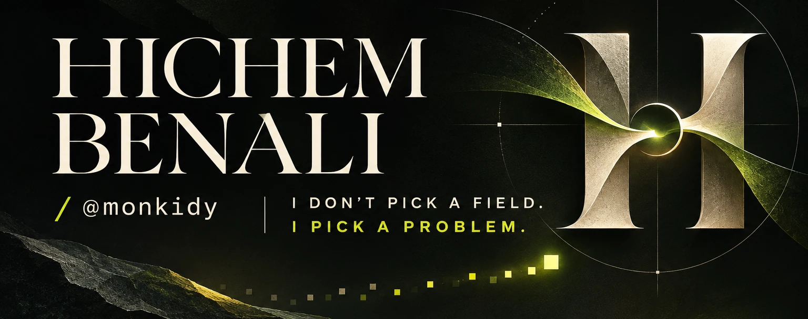
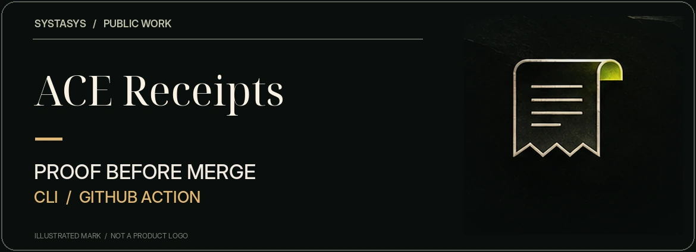
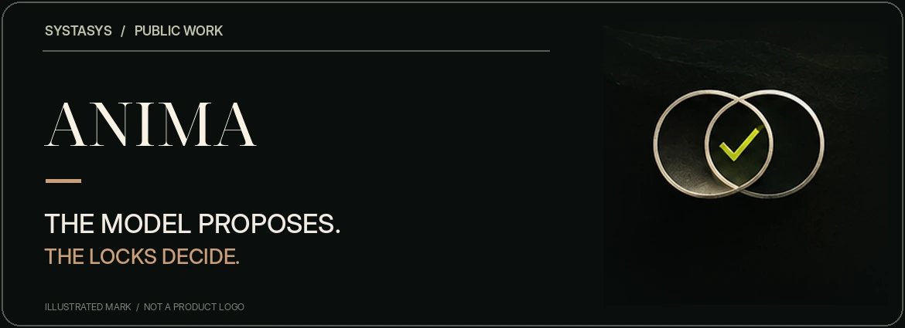
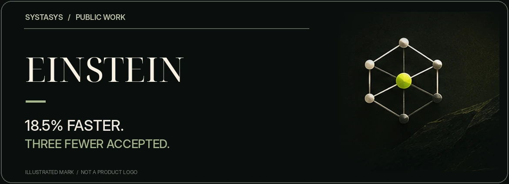

  <picture>
    <source media="(max-width: 600px)" srcset="assets/hichem-hero-mobile.webp">
    
  </picture>

**I don't pick a field. I pick a problem.**

I move between people, operations and technical systems. **Asso** is the AI partner I built to keep context, challenge decisions and help turn ideas into things we can test. **SYSTASYS** is the larger work these pieces belong to. The decisions remain mine.

Some of that work stays private. What follows can be inspected.

[**My website**](https://hichembenali.com/en) · [How it began](https://hichembenali.com/en/manifesto) · [Work, dates and results](https://hichembenali.com/en/work)

---

## Selected work

### 01 / [SkeptOpus](https://github.com/systasys/skeptopus)

*AI can say it shipped. What actually happened?* A local checker examines observable evidence behind AI coding claims: files, commits, tests and deployments. It reports what it could verify, not that the work is good.

[Code and explanation](https://github.com/systasys/skeptopus)

### 02 / [ACE Receipts](https://github.com/monkidy/ace-receipts)

<a href="https://github.com/monkidy/ace-receipts"><picture><source media="(max-width: 600px)" srcset="assets/ace-project-card-mobile.webp"></picture></a>

Deterministic checks of agent-written workflows and diffs for evidence, risk and permission. Human review is still necessary.

[Explore the CLI and demo](https://github.com/monkidy/ace-receipts) · [npm](https://www.npmjs.com/package/ace-receipts)

### 03 / [ANIMA](https://github.com/monkidy/anima-pay)

<a href="https://github.com/monkidy/anima-pay"><picture><source media="(max-width: 600px)" srcset="assets/anima-project-card-mobile.webp"></picture></a>

An AI agent may propose a payment; a human mandate, PayPal payer approval and authorized release determine whether a **sandbox** capture can proceed. Submitted to the PayPal AI Hackathon on 11 November 2026; result pending.

[Inspect the evidence](https://github.com/monkidy/anima-pay) · [Sandbox demonstration](https://anima-demo.onrender.com)

---

## Outside the lab

I keep the outcomes that weren't flattering, too.

<a href="https://github.com/monkidy/einstein-matchmaker"><picture><source media="(max-width: 600px)" srcset="assets/einstein-project-card-mobile.webp"></picture></a>

- **[EINSTEIN Matchmaker](https://github.com/monkidy/einstein-matchmaker)** — four agents finished the same benchmark 18.5% faster than one, but accepted **9** proposals instead of **12**. Not among the winners announced on 7 November 2026.
- **[MIREX 2026](https://music-ir.org/mirex/wiki/2026:Music_Evaluation_via_CMI-RewardBench_Results)** — last of 13; 39.8% correct against 59% for a trivial always-B baseline.
- **[Formula E Creators Challenge](https://hichembenali.com/en/work#formula-e)** — film submitted in September 2026; not among the nine finalists.

Other public directions: [Sendable?](https://trysendable.com/) (a second look before sending a message) · [Asso on YouTube](https://www.youtube.com/@asso.systasys) (synthetic voice and face disclosed) · [SYSTASYS External](https://www.youtube.com/@systasys.external) (competition films).

---

### About this account

I use this account with AI coding agents; much of the code was written with their help. I select the public work, make the decisions and keep the private source, methods and data private. A repository, a demo and a result are different kinds of evidence. I try not to present one as another.
