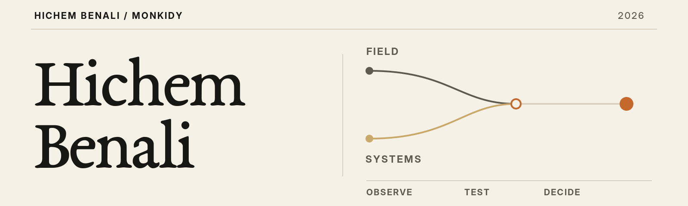

  <picture>
    <source media="(max-width: 600px) and (prefers-color-scheme: dark)" srcset="assets/profile-hero-mobile-dark.png">
    <source media="(max-width: 600px)" srcset="assets/profile-hero-mobile-light.png">
    <source media="(prefers-color-scheme: dark)" srcset="assets/profile-hero-dark.png">
    
  </picture>

### I don't pick a field. I pick a problem.

I work across people, operations and technical systems. **Asso** is my AI partner for keeping context, questioning decisions and helping turn ideas into things we can test. **SYSTASYS** is where much of that work connects. I remain responsible for the decisions.

The private work stays private. These are pieces you can inspect.

[**My website**](https://hichembenali.com/en) · [How it began](https://hichembenali.com/en/manifesto) · [Work, dates and results](https://hichembenali.com/en/work)

---

## Selected work

### 01 / [SkeptOpus](https://github.com/systasys/skeptopus)

*AI can say it shipped. What actually happened?*

A local checker that looks for observable evidence behind an AI agent's claims: files, commits, tests and deployments. It reports what it could verify and what it could not. It does **not** certify the quality of the work.

[Explore the project](https://github.com/systasys/skeptopus)

### 02 / [ACE Receipts](https://github.com/monkidy/ace-receipts)

*Before a change is accepted, look at the receipt.*

A local CLI and GitHub Action that review agent-written workflows and diffs for evidence, risk and permission. Deterministic checks; human review still matters.

[Open the code](https://github.com/monkidy/ace-receipts) · [Try on npm](https://www.npmjs.com/package/ace-receipts)

### 03 / [ANIMA](https://github.com/monkidy/anima-pay)

*An experiment in knowing when an AI must wait.*

An AI-and-PayPal experiment where an agent proposes, but scoped authority and payer approval govern whether a sandbox payment may proceed. **Test money only.** Submitted to the PayPal AI Hackathon on 11 November 2026; the result remains pending.

[Open the source and evidence](https://github.com/monkidy/anima-pay) · [Visit the sandbox demonstration](https://anima-demo.onrender.com)

---

## Outside the lab

I keep the outcomes that weren't flattering, too.

- **[EINSTEIN Matchmaker](https://github.com/monkidy/einstein-matchmaker)** — four agents finished the same benchmark 18.5% faster than one, but accepted **9** proposals instead of **12**. Not among the winners announced on 7 November 2026.
- **[MIREX 2026](https://music-ir.org/mirex/wiki/2026:Music_Evaluation_via_CMI-RewardBench_Results)** — last of 13; 39.8% correct against 59% for a trivial always-B baseline.
- **[Formula E Creators Challenge](https://hichembenali.com/en/work#formula-e)** — film submitted in September 2026; not among the nine finalists.

Other public directions: [Sendable?](https://trysendable.com/) (a second look before sending a message) · [Asso on YouTube](https://www.youtube.com/@asso.systasys) (synthetic voice and face disclosed) · [SYSTASYS External](https://www.youtube.com/@systasys.external) (competition films).

---

### About this account

I use this account with AI coding agents; much of the code was written with their help. I select the public work, make the decisions and keep the private source, methods and data private. A repository, a demo and a result are different kinds of evidence. I try not to present one as another.
