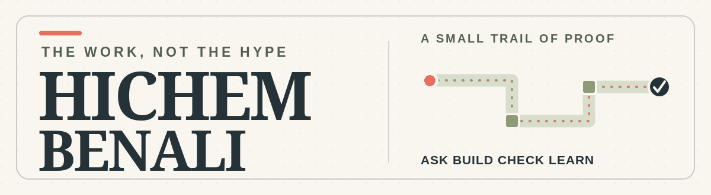

  

# Hichem Benali

**I don't pick a field. I pick a problem.**

I build **SYSTASYS** with a team of AI agents led by **Asso**, my AI partner. I make the decisions; the agents help turn questions into things we can test. The core stays private. What we share publicly includes experiments that failed, not just the wins.

:house: [My website](https://hichembenali.com/en) &nbsp; :compass: [Why I built it](https://hichembenali.com/en/manifesto) &nbsp; :mag: [Dated work and verdicts](https://hichembenali.com/en/work)

---

## :sparkles: Things you can explore

### :octopus: [SkeptOpus](https://github.com/systasys/skeptopus)

When an AI says something is done, SkeptOpus checks observable evidence - files, commits, tests, and more. A local, open-source project from SYSTASYS. It reports what it could and could not verify; it does not certify code quality.

### :mag_right: [ACE Receipts](https://github.com/monkidy/ace-receipts)

A small public tool for reviewing AI-agent work against proof, risk, and permission before accepting it. Released June 2026 under Apache-2.0. Also on [npm](https://www.npmjs.com/package/ace-receipts).

### :speech_balloon: [Sendable?](https://trysendable.com/)

A quick second look at a draft before sending it: send, revise, or don't send.

### :movie_camera: [Asso](https://www.youtube.com/@asso.systasys)

My AI partner explains and explores ideas on video. Its synthetic voice and face are explicitly disclosed. The [SYSTASYS External](https://www.youtube.com/@systasys.external) channel documents outside challenges.

---

## :test_tube: Judged outside our circle

**Not every attempt worked. That's part of the record.**

- **[ANIMA](https://github.com/monkidy/anima-pay)** - PayPal AI Hackathon, November 2026. Submitted November 11; verdict expected December 21. A proposed gate between AI agents and payment actions.
- **[EINSTEIN Matchmaker](https://github.com/monkidy/einstein-matchmaker)** - NTP Novi Sad Hackathon, October 2026. Four agents finished 18.5% faster than one, but kept only 9 of 24 proposals instead of 12; not among the winners announced November 7. [Watch the film](https://www.youtube.com/watch?v=nyJowCVr-DI).
- **[MIREX 2026](https://music-ir.org/mirex/wiki/2026:Music_Evaluation_via_CMI-RewardBench_Results)** - Last of 13 in a music preference prediction evaluation. 39.8% correct versus 59% for the always-B baseline.
- **Formula E Creators Challenge 2026** - A short film submitted in September; not among the nine finalists. [See the work](https://hichembenali.com/en/work#formula-e).

---

## :seedling: How I work

Curiosity across fields. Humans responsible for decisions. AI agents acknowledged for their contribution. Public claims linked to public evidence. No invented victories, no fake activity counters, and no private architecture exposed.

The most important work at SYSTASYS remains private. This profile is a window into the parts others can inspect.
